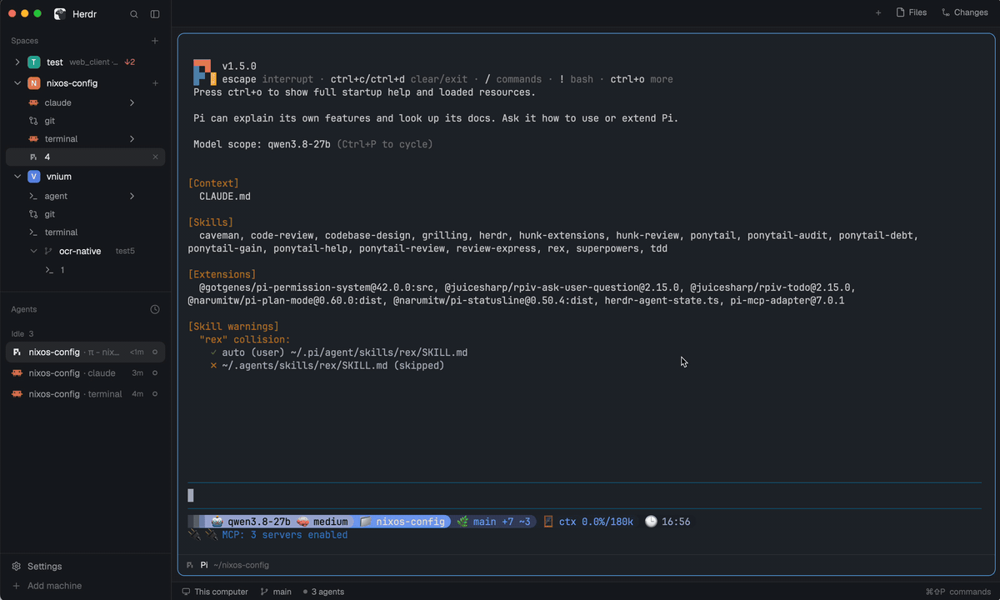
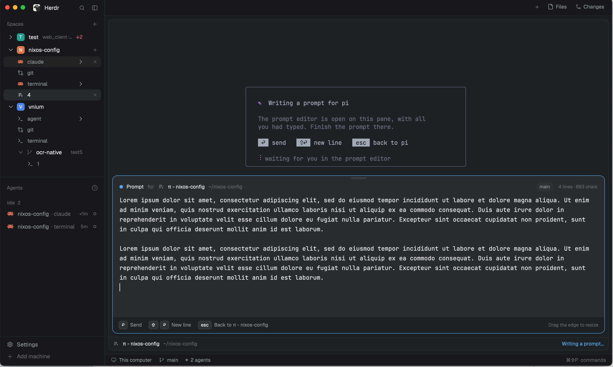

# herdr-prompt-editor

**A real editor for your coding-agent prompts, right inside [Herdr](https://herdr.dev).**
Press <kbd>Ctrl</kbd>+<kbd>G</kbd> in Claude Code, Codex or pi and a proper
editor slides up under the agent, with everything you had already typed.



## Why

Coding agents are driven by prompts, and the good ones are long: the task, the
constraints, the files to look at, what "done" means. Yet every agent asks you
to write them in a one-line terminal input, where

- the mouse does nothing: no clicking into the middle of a sentence, no
  selecting a paragraph to rewrite it;
- a new line is a guess (<kbd>Shift</kbd>+<kbd>Enter</kbd>? <kbd>Alt</kbd>+<kbd>Enter</kbd>?
  <kbd>\\</kbd>?) and one wrong <kbd>Enter</kbd> sends half a thought;
- long text wraps into an unreadable block and undo barely exists.

The agents know this, so they all let you press <kbd>Ctrl</kbd>+<kbd>G</kbd> to
open the prompt in an external editor. That usually means a whole vim session or
a separate GUI window you then have to switch away from and back to.

herdr-prompt-editor is that external editor, built into Herdr: it opens in the
same pane, under the agent you are talking to, looks like the rest of Herdr, and
sends the prompt the moment you press <kbd>Enter</kbd>.

## What you get

- **A real text editor**: click anywhere, drag to select, double-click a word,
  <kbd>⌥</kbd>/<kbd>⌘</kbd> + arrows by word and line, undo and redo, soft wrap,
  native input methods.
- **Your draft comes along**: whatever you had typed in the agent is in the
  editor when it opens; <kbd>Esc</kbd> puts it back, edited.
- **Docked under the agent**, in that pane, with the agent's name, folder and
  git branch above the text and a line/character count.
- **Resizable**: drag the top edge; the height is remembered. Double-click the
  edge to let it grow with the text again.
- **Every agent at once**: Claude Code, Codex and pi, through the one setting
  they all share (`$VISUAL`).
- **Nothing else changes**: `git commit` and every other program keep your
  usual editor, and so does everything outside Herdr.
- **Local only**: no network, no telemetry; it reads and writes the agent's own
  prompt file and nothing else.

| Key | |
|---|---|
| <kbd>Enter</kbd> | send the prompt to the agent |
| <kbd>Shift</kbd>+<kbd>Enter</kbd> | new line |
| <kbd>Esc</kbd> | back to the agent, with the text in its input, unsent |

While you write, the agent's screen shows a card saying where the prompt went;
the agent comes back exactly as it was when you are done.



## Install

Ask the agent in your Herdr window to install
`herdr.dev/mods/korolr/herdr-prompt-editor`, or by hand:

```sh
git clone https://github.com/korolr/herdr-prompt-editor
cp -R herdr-prompt-editor/mods/prompt-editor ~/.config/herdr-app/mods/
cp herdr-prompt-editor/layouts/prompt-editor.json ~/.config/herdr-app/layouts/
```

Then hook up your agents (next section) — that part matters: without it
<kbd>Ctrl</kbd>+<kbd>G</kbd> keeps opening your old editor.

## Hook up your agents

Claude Code, Codex and pi all open the prompt in `$VISUAL` when you press
<kbd>Ctrl</kbd>+<kbd>G</kbd>. Point it at this mod's `editor.sh`, once, in your
shell's rc file (`~/.zshrc` or `~/.bashrc`):

```sh
export VISUAL="sh $HOME/.config/herdr-app/mods/prompt-editor/editor.sh"
export PROMPT_EDITOR_FALLBACK=nvim   # the editor you use for everything else
```

Open a new terminal and start your agent again so it picks the variable up.
That is all: no agent settings to change.

`editor.sh` takes over only when **both** hold, and otherwise opens the file in
`PROMPT_EDITOR_FALLBACK` untouched:

1. it runs in a Herdr terminal;
2. a coding agent started it (one of its nearest parent processes is named
   `claude`, `codex`, `pi`, `opencode` or `gemini`).

So `git commit`, `crontab -e` and anything outside Herdr behave exactly as
before.

| Agent | Key | Reads | Notes |
|---|---|---|---|
| Claude Code | <kbd>Ctrl</kbd>+<kbd>G</kbd> | `$VISUAL`, then `$EDITOR` | |
| Codex | <kbd>Ctrl</kbd>+<kbd>G</kbd> | `$VISUAL`, then `$EDITOR` | 0.78 or later; `/keymap` → `open_external_editor` to rebind |
| pi | <kbd>Ctrl</kbd>+<kbd>G</kbd> | its `externalEditor` setting, then `$VISUAL` | if you set `externalEditor`, point it at the same command |

Agents started from Herdr's **New** menu run in your login shell, so they get
the variable from your rc file too.

<details>
<summary>Rather not touch <code>$VISUAL</code> for your whole shell?</summary>

Wrap just the agents:

```sh
pe="sh $HOME/.config/herdr-app/mods/prompt-editor/editor.sh"
claude() { VISUAL="$pe" PROMPT_EDITOR_FALLBACK=nvim command claude "$@"; }
codex()  { VISUAL="$pe" PROMPT_EDITOR_FALLBACK=nvim command codex "$@"; }
pi()     { VISUAL="$pe" PROMPT_EDITOR_FALLBACK=nvim command pi "$@"; }
```

</details>

## Docked or in a dialog

The editor docks to a pane through the pane's header bar, which the layout
decides. Two ways to get it docked:

- **Use the bundled layout**: <kbd>Cmd</kbd>+<kbd>Shift</kbd>+<kbd>L</kbd> until it
  shows *prompt-editor*. It is Herdr's main layout with the pane header moved
  to the bottom, so the editor slides up from under the agent.
- **Keep your own layout** and change its pane header (the `"pane"` of the
  `"tab": "active"` block) to:

  ```json
  "header": { "content": { "mod": "prompt-editor" }, "height": 32, "position": "bottom", "reveal": "always" }
  ```

  The bar looks and works like Herdr's own pane header (program, folder,
  status, split/zoom/close on hover). Leave `"position": "top"` if you prefer
  the header up there: the editor then opens downwards from it.

In any layout without it, <kbd>Ctrl</kbd>+<kbd>G</kbd> still works: the editor
opens as a dialog in the middle of the window.

## Settings

| Variable | |
|---|---|
| `PROMPT_EDITOR_FALLBACK` | editor command for everything that is not an agent in Herdr; unset: `editor.sh` exits with code 3, for wrappers that pick an editor themselves |
| `PROMPT_EDITOR_AGENTS` | process names counted as agents (default `claude codex pi opencode gemini`) |
| `PROMPT_EDITOR_FORCE=1` | skip the agent check, for a wrapper that only agents call |
| `PROMPT_EDITOR_DEBUG=1` | log every hand-off to `~/.config/herdr-app/data/prompt-editor/debug.log`; while that file exists, each editor that receives a request posts a notification |

## How it works

When you press <kbd>Ctrl</kbd>+<kbd>G</kbd>, the agent writes your current
input to a temporary file and runs `$VISUAL` on it. `editor.sh` leaves that
file's path under `~/.config/herdr-app/data/prompt-editor/`, asks Herdr to
open the editor (`herdr-app do prompt-editor.open`, or `mod.open` for the
dialog) and draws its card in the agent's terminal. The editor under the
agent's pane reads the file; <kbd>Enter</kbd> or <kbd>Esc</kbd> writes your
text back and tells `editor.sh`, which exits so the agent reads the file in
again, and for <kbd>Enter</kbd> presses Enter in that terminal (`hc keys`).

## Troubleshooting

- **<kbd>Ctrl</kbd>+<kbd>G</kbd> opens your old editor**: the agent was started
  before you set `$VISUAL`; start it again in a new terminal.
- **The agent waits and nothing opens**: run the agent with
  `PROMPT_EDITOR_DEBUG=1` and look at `debug.log`; <kbd>Ctrl</kbd>+<kbd>C</kbd>
  in the agent gives up waiting.

## Requirements

Herdr's desktop app 0.1.15 or later, a POSIX `sh` and `ps`. Tested on macOS.

## License

MIT, see [LICENSE](LICENSE).
