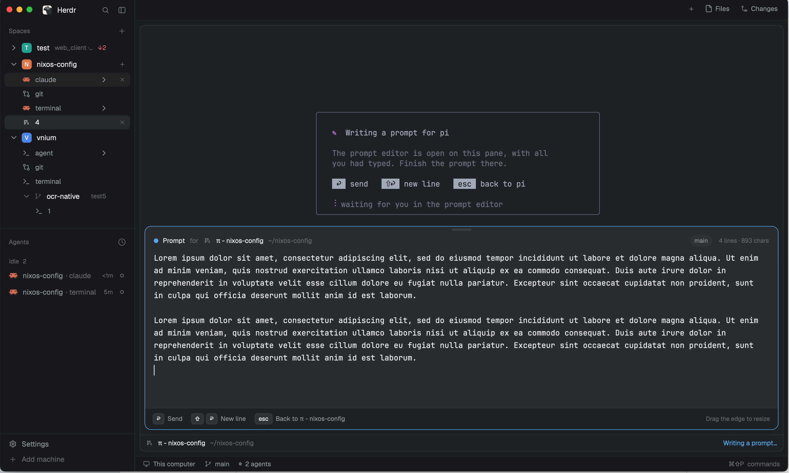

# herdr-prompt-editor

A prompt editor for coding agents, docked under the agent's pane. Ctrl+G in
Claude Code, Codex or pi opens it with what was already typed; Enter sends the
prompt, Shift+Enter is a new line, Esc hands the text back unsent. Each pane's
bar is Herdr's pane header, moved to the bottom, and the editor slides up out
of it. Without the bar in the layout it opens as a dialog instead.

## What you see

- **Pane bar** (the pane header, 32 px, at the bottom of every pane, `background`
  fill, 1 px `border` line on its terminal side): the program's 14 px icon, its
  name in `foreground` medium (max 260 px, truncated), the folder (`~` for home)
  in `dim` filling the rest, then the status (below). While the editor is open
  for this pane, "Writing a prompt…" in `accent` sits before the status. On
  hover: split right, split down, zoom/unzoom and close buttons (14 px icons,
  3 px padding, `hover` background), using the shipped `pane` mod's SVGs.
- **Editor card**, anchored to the bar's top-left and as wide as the pane, with
  8 px clear on the sides and bottom: radius 12, `popover` fill, 1 px border in
  `accent` while the text has focus and `border` otherwise, an extra-large
  shadow. Top to bottom:
  - a centred 36×4 grabber (radius 2, `border`; `accent` while dragged) in the
    top 12 px;
  - a header row (16 px sides, 16 px top): an 8 px `accent` dot, "Prompt" in
    semibold `foreground`, "for" in `dim`, the program icon (15 px) and name in
    `foreground` medium, the folder in `dim` (truncated), the git branch as a
    20 px `raised` pill (radius 10, 11 px `muted`), "N lines · N chars" in 11 px
    `dim`;
  - the text area: the theme's monospace font, 14 px, line height 1.6, 16 px
    sides; 12 rows minimum, growing to 28, or the dragged height;
  - a footer (`surface` fill, `border` line above, radius 12 at the bottom):
    keycaps (20 px high, radius 5, `raised` fill, `border` outline, 11 px
    medium) "↩" Send, "⇧" "↩" New line, "esc" Back to <agent>, and at the right
    in 11 px `dim` "Drag the edge to resize" (or "Double-click the edge to
    auto-size" once a height is set).
- **Dialog** (no bar in the layout): the same card without its own border,
  shadow and grabber, 75 % of the window wide, modal.
- **In the agent's terminal while editing**, drawn by `editor.sh` on the
  alternate screen: a rounded box (64 columns, dim lines) above the middle
  with "✎ Writing a prompt for <agent>" (pen in magenta, text bold), two dim
  lines saying the editor is open on this pane, the three keys as reverse-video
  caps, and a magenta braille spinner with "waiting for you in the prompt
  editor". Under 52 columns or 14 rows it is three plain lines.

## How it behaves

- Status in the bar, as Herdr's header: working is a 12 px `working` spinner
  (`mods/workspace-chrome/spinner.svg`, 900 ms); blocked is a "Needs you" pill
  (`blocked` text on `blocked` at 15 % alpha); done is a 7 px `done` dot; idle
  shows nothing.
- Clicking the bar focuses its pane.
- Ctrl+G in an agent runs `$VISUAL`, i.e. `editor.sh <file>`; the editor opens
  under that agent's pane with the file's text, the cursor at the end, fading in
  over ~120 ms.
- Enter: the text (without the newline the textarea just inserted) is written
  to the agent's file, the editor closes, the pane gets focus back, and Enter
  is pressed in the agent 0.3 s after `editor.sh` exits. Shift+Enter inserts a
  line break. Esc writes the text back without Enter; so does closing the
  dialog.
- Dragging the grabber resizes the text area (60–1400 px); the height is kept
  in shared state `prompt-editor.height` across restarts; double-click resets.
- The card follows the pane's width live, at any zoom.

## Built from

- `mods/prompt-editor/` — `main.js`, `mod.json`
  (`{"place":"none","overlay":{"kind":"dialog","width":0.75,"modal":true}}`),
  `editor.sh`.
- `layouts/prompt-editor.json` — Herdr's `main` layout with the active tab's
  pane header set to `{"content":{"mod":"prompt-editor"},"height":32,"position":"bottom","reveal":"always"}`.
- Pane-header copies (`props().pane`, `props().terminal`) render the bar inside
  `Popup.new(id, bar).anchor("bottom_left")` (`"top_left"` when the layout's
  header is on top, read from `layout()`); the card is the popup's content,
  present only while a request is open. The dialog copy (`props().overlay`, no
  pane) renders the card alone.
- Editing: `TextareaState` + `Textarea` from `gpui-base`; `submit` events carry
  `shift`/`secondary`; `focus`/`blur` drive the border.
- `herdr`: `panes`, `layout`, `theme`, `settings` (`zoom`, `font_family`),
  `home`, `appHome`, `nextCommand` (`open`), `readTextFile`, `writeTextFile`,
  `shared`/`setShared`, `run` (`pane.focus`, `pane.split`, `pane.zoom`,
  `pane.close`), `notify`, `closeOverlay`.
- `editor.sh` (POSIX sh): checks `HC_TERMINAL_ID` and its parent processes
  (`ps`), writes `data/prompt-editor/<terminal>.req` with the file's path, runs
  `herdr-app do prompt-editor.open` (on failure writes `data/prompt-editor/pending`
  and runs `herdr-app do mod.open '{"name":"prompt-editor"}'`), draws its card,
  waits for `<terminal>.done` (`submit` or `keep`), then `hc keys <terminal>
  enter` in the background for `submit`.

## Watch out

- A handler's `cx` dies when the handler returns: anything after an `await`
  must run on the `cx` from `init` (an AsyncContext) or a `cx.spawn` task.
- `on_size_change` reports sizes before zoom; divide by `settings().zoom`, or the
  card is wider than the pane.
- The textarea inserts the newline before `submit` fires; send the text from
  before that change.
- `<mod>.<command>` reaches shown copies only; with no copy in the layout it
  fails as an unknown command — that is the signal for the dialog.
- Esc closes a dialog before the mod's key handler runs: hand the text back
  in the view's `close()` too.
- The agent leaves its screen to the editor; without the card the pane is blank.
- The agent check matches process names; agents run under another name need
  `PROMPT_EDITOR_AGENTS`.

## Done when

- Ctrl+G in Claude Code, Codex and pi, each started with `VISUAL` set to
  `editor.sh`, opens the editor under that pane with the typed text and the
  cursor at its end; the terminal shows the card.
- Enter sends the edited prompt to the agent; Esc leaves it in the agent's
  input unsent; Shift+Enter adds a line.
- With the bar in a top header the editor opens downwards; in a layout without
  it, as a dialog.
- `git commit` in a Herdr terminal with the same `VISUAL` opens
  `PROMPT_EDITOR_FALLBACK`.
- Dragging the grabber resizes the editor and the size survives a restart.
